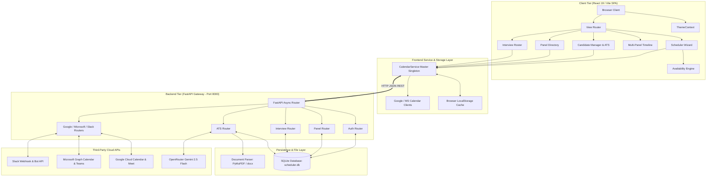
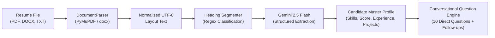

# SUG - Technical Architecture & Engineering Specifications

This document outlines the detailed architectural decisions, data models, state machines, and mathematical algorithms underpinning the **SUG Panel Scheduler** platform.

---

## 1. System Topology & Component Hierarchy

---

## 2. Mathematical Interval Availability Engine

The availability calculation engine is deterministic and executes in the client's browser without network overhead.

### Model Formalization
Let $T = [0, 1439]$ represent the timeline in minutes from midnight $00:00$ to $23:59$.
For each panelist $p_i \in P$, their working window is defined as:
$$W_i = [w_{i,\text{start}}, w_{i,\text{end}}] \subseteq T$$

Let $B_i = \{ b_{i,1}, b_{i,2}, \dots, b_{i,n} \}$ be the set of busy event intervals for panelist $p_i$ on a given date $d$.
Each busy event is clamped to the panelist's working hours:
$$b_{i,j}' = [\max(w_{i,\text{start}}, b_{i,j}.\text{start}), \min(w_{i,\text{end}}, b_{i,j}.\text{end})]$$

### Interval Merging Algorithm
The set of clamped busy intervals is sorted by start time and merged into disjoint intervals:
$$\bar{B}_i = \text{Merge}(B_i')$$

### Free Time Computation
The free time intervals $F_i$ for panelist $p_i$ are the complement of $\bar{B}_i$ relative to $W_i$:
$$F_i = W_i \setminus \bar{B}_i$$

### Multi-Panel Intersection
For a selected set of panelists $P = \{p_1, p_2, \dots, p_K\}$, the common free availability intervals $F_{\text{common}}$ are computed via recursive intersection:
$$F_{\text{common}} = \bigcap_{i=1}^K F_i$$

### Discrete Slot Discretization
For a requested interview duration $\Delta$ (e.g. 60 mins) and step interval $\sigma$ (e.g. 30 mins):
$$\text{Slots} = \{ [s, s + \Delta] \mid \exists [a, b] \in F_{\text{common}} \text{ s.t. } a \le s \text{ and } s + \Delta \le b \}$$

---

## 3. ATS Document Ingestion & Feature Extraction

### Extraction Specifications
1. **Name & Contact Detection**: Email and phone patterns extracted with regex verification.
2. **Experience Normalization**: Multi-date range parser normalizes dates to standard `YYYY-MM` formats and calculates total experience in years.
3. **Skill Vectoring**: Tokenizes primary and secondary technical skills for algorithmic probing.
4. **ATS Scoring Formula**:
   $$\text{ATS Score} = w_s \cdot S_{\text{skills}} + w_e \cdot S_{\text{exp}} + w_p \cdot S_{\text{proj}} + w_c \cdot S_{\text{clarity}}$$
   *Default Weights:* $w_s = 0.40, w_e = 0.30, w_p = 0.20, w_c = 0.10$.

---

## 4. Design System Architecture

SUG implements a dual-mode styling architecture powered by Tailwind CSS and CSS variables.

### Theme Modes
1. **Modern Clean**:
   - Font Family: Inter / System UI
   - Borders: `1px solid rgba(226, 232, 240, 0.8)`
   - Shadows: Soft diffuse ambient shadows (`box-shadow: 0 4px 6px -1px rgb(0 0 0 / 0.05)`)
   - Rounded corners: `rounded-2xl`
2. **Neo-Brutalism**:
   - Font Family: JetBrains Mono / Space Grotesk
   - Borders: `3px solid #000000` (Light) / `3px solid #ffffff` (Dark)
   - Shadows: Hard offset shadows (`box-shadow: 4px 4px 0px #000000`)
   - Rounded corners: `rounded-none` or `rounded-lg` with sharp contrast

Both modes operate seamlessly with **Dark / Light mode** toggles managed via React Context (`ThemeContext.tsx`).
