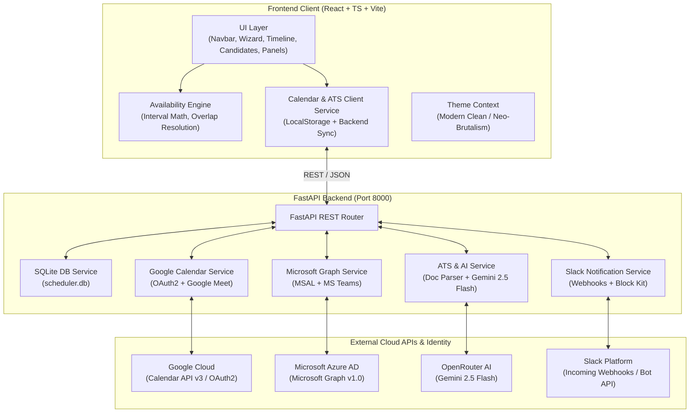
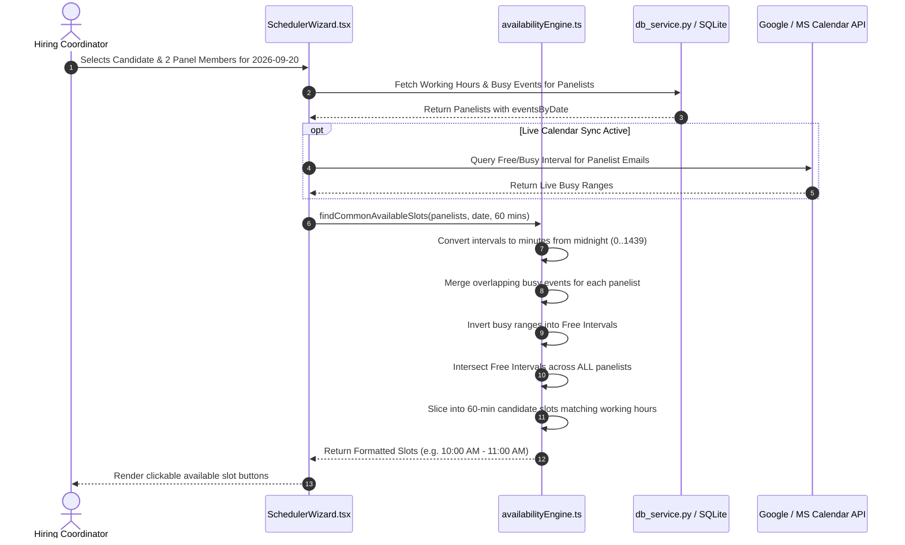
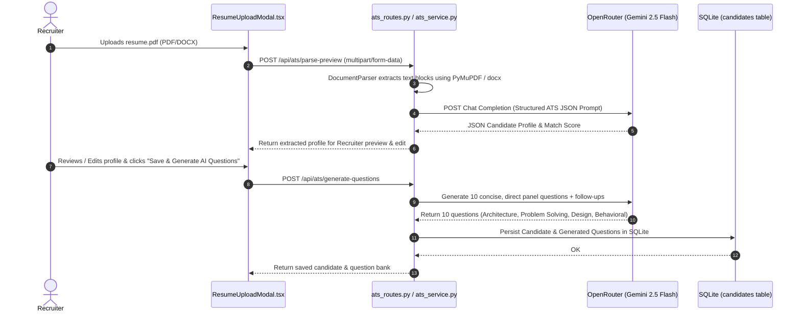
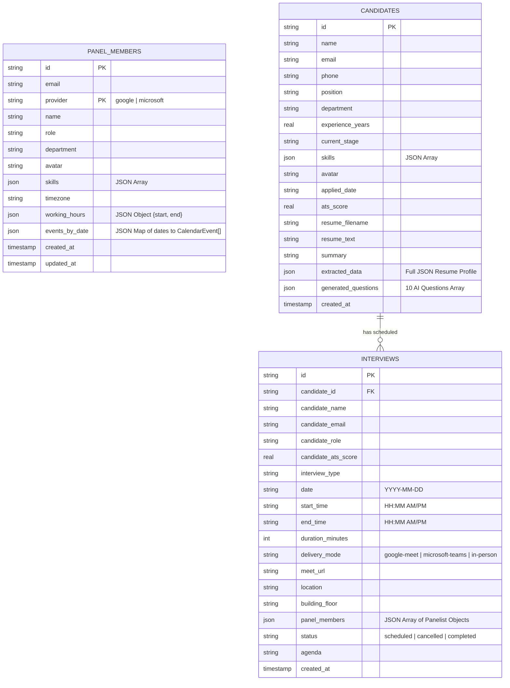

# SUG Panel Scheduler - Developer Handover & Production Documentation

**Project Version:** 1.0.0  
**Target Environment:** Node.js (v18+) & Python (3.10+)  
**Documentation Updated:** September 2026  
**Primary Maintainers:** Engineering & Core Infrastructure Teams  

---

## Table of Contents

1. [Executive Summary & Project Purpose](#1-executive-summary--project-purpose)
2. [Technology Stack & Dependencies](#2-technology-stack--dependencies)
3. [System Architecture & High-Level Diagrams](#3-system-architecture--high-level-diagrams)
4. [Repository Structure & Module Responsibilities](#4-repository-structure--module-responsibilities)
5. [Core Features & User Workflows](#5-core-features--user-workflows)
6. [End-to-End Data Flows](#6-end-to-end-data-flows)
7. [Backend API Reference](#7-backend-api-reference)
8. [Database Schema & Persistence Layer](#8-database-schema--persistence-layer)
9. [Authentication, OAuth 2.0 & SSO](#9-authentication-oauth-20--sso)
10. [ATS Resume Extraction & Gemini AI Engine](#10-ats-resume-extraction--gemini-ai-engine)
11. [Deterministic Availability & Slot Calculation Algorithm](#11-deterministic-availability--slot-calculation-algorithm)
12. [State Management, Caching & Offline Fallbacks](#12-state-management-caching--offline-fallbacks)
13. [Security, Least-Privilege & Credential Policy](#13-security-least-privilege--credential-policy)
14. [Local Development Setup & Verification](#14-local-development-setup--verification)
15. [Automated Testing Suite](#15-automated-testing-suite)
16. [Production Deployment & Containerization Guide](#16-production-deployment--containerization-guide)
17. [Troubleshooting & Common Failure Modes](#17-troubleshooting--common-failure-modes)
18. [Known Limitations, Technical Debt & Roadmap](#18-known-limitations-technical-debt--roadmap)
19. [Developer Extension Guide (How to Add Features)](#19-developer-extension-guide-how-to-add-features)
20. [New Developer Onboarding Checklist](#20-new-developer-onboarding-checklist)

---

## 1. Executive Summary & Project Purpose

**SUG (Smart Unified Gathering)** is an enterprise interview scheduling platform and availability engine designed for modern hiring teams. It bridges the gap between disparate calendar ecosystems, candidate ATS tracking, and panel coordination.

### Core Problem Solved
Traditional interview scheduling requires manual cross-checking between multiple interviewers' Google Workspace or Microsoft 365 calendars, time zones, room availability, and candidate resumes. SUG automates this by:
1. **Multi-Calendar Unification**: Reading real-time busy schedules from both **Google Calendar** and **Microsoft 365 Graph API** in a unified timeline.
2. **Deterministic Overlap Engine**: Computing intersection intervals across multiple panelists within custom working hours to find collision-free interview slots in milliseconds.
3. **Automated Meeting Provisioning**: Automatically creating **Google Meet** or **Microsoft Teams** video links and sending invites with candidate agendas.
4. **ATS Resume AI Extraction**: Ingesting candidate resumes (PDF, DOCX, TXT) via layout-aware segmentation and **OpenRouter Gemini 2.5 Flash** for candidate profiling, skill parsing, and ATS match scoring.
5. **Conversational Question Generation**: Generating 10 role-tailored, direct interview questions with follow-up probes across 4 competency categories.
6. **Slack Collaboration**: Dispatching interactive Block Kit notifications to hiring channels for scheduling, cancellations, and daily interview roundups.

---

## 2. Technology Stack & Dependencies

### Frontend (`frontend/`)
| Component | Technology | Version | Purpose |
| :--- | :--- | :--- | :--- |
| **Framework** | React | `^19.0.0` | Declarative UI rendering |
| **Language** | TypeScript | `~5.7.2` | Static typing and interface contracts |
| **Build Tool** | Vite | `^6.2.0` | Fast HMR dev server & production bundling |
| **Styling** | Tailwind CSS | `^4.0.0` | Utility-first CSS with theme variables |
| **Icons** | Custom SVG (`icons.tsx`) | Zero-dep | Lucide-compatible icons (strict zero-emoji policy) |
| **Testing** | Vitest | `^3.0.7` | Unit and integration test runner |

### Backend (`backend/`)
| Component | Technology | Version | Purpose |
| :--- | :--- | :--- | :--- |
| **Framework** | FastAPI | `^0.115.0` | High-performance async REST API framework |
| **ASGI Server** | Uvicorn | `^0.32.0` | Production ASGI web server |
| **Database** | SQLite3 (Standard Lib) | Built-in | Zero-config embedded relational store (`scheduler.db`) |
| **HTTP Client** | HTTPX | `^0.28.0` | Async HTTP requests for OAuth, Graph & Gemini API |
| **Document Parsing** | PyMuPDF (`fitz`), PyPDF2, python-docx | `^1.25.0` | Multi-format PDF and Word document extraction |
| **OAuth & Calendar** | `google-auth`, `google-api-python-client` | `^2.150.0` | Google Calendar & OAuth 2.0 integration |
| **MS Graph SDK** | `msal` | `^1.31.0` | Microsoft Authentication Library for Azure AD |

---

## 3. System Architecture & High-Level Diagrams

### Architecture Overview


---

## 4. Repository Structure & Module Responsibilities

```
SUG/
├── docs/                                # Production & Handover Documentation
│   ├── DEVELOPER_HANDOVER.md            # Master developer guide (this document)
│   └── ARCHITECTURE.md                  # Detailed architectural specifications
├── backend/                             # Python FastAPI Backend
│   ├── main.py                          # Application entry point, CORS, and route mounting
│   ├── scheduler.db                     # SQLite database file
│   ├── requirements.txt                 # Python pip dependencies
│   ├── .env.example                     # Sample environment variable template
│   ├── oauth/                           # OAuth 2.0 authentication handlers
│   │   ├── google_oauth.py              # Google OAuth consent URL, token exchange, profile lookup
│   │   ├── microsoft_oauth.py           # Azure AD MSAL OAuth URL, token exchange, profile lookup
│   │   └── slack_oauth.py               # Slack OAuth and workspace identity
│   ├── routes/                          # REST API endpoint definitions
│   │   ├── auth_routes.py               # /auth endpoints, SSO callbacks, user profile lookup
│   │   ├── ats_routes.py                # /api/ats endpoints for resume parse & questions
│   │   ├── panel_routes.py              # /api/panel-members CRUD & sync
│   │   ├── interview_routes.py          # /api/interviews CRUD, cancellations & deletions
│   │   ├── google_calendar_routes.py    # /api/calendar Google event creation & free/busy
│   │   ├── microsoft_calendar_routes.py # /api/microsoft MS Graph event creation & free/busy
│   │   └── slack_routes.py              # /api/slack notifications & test webhooks
│   └── services/                        # Business logic and external API clients
│       ├── db_service.py                # SQLite schema migration, CRUD helpers, serialization
│       ├── ats_service.py               # Resume text extraction, Gemini prompt, questions engine
│       ├── google_calendar_service.py   # Google Calendar API wrapper & Meet link generator
│       ├── microsoft_calendar_service.py# MS Graph calendar client & Teams meeting creator
│       └── slack_service.py             # Slack Block Kit message composer & dispatch
└── frontend/                            # React + TypeScript Frontend
    ├── package.json                     # Node dependencies & npm scripts
    ├── vite.config.ts                   # Vite build configuration
    ├── index.html                       # HTML shell
    └── src/
        ├── App.tsx                      # Root component, routing, auth state, provider switcher
        ├── types/
        │   └── index.ts                 # Master TypeScript type definitions and interfaces
        ├── context/
        │   └── ThemeContext.tsx         # Theme provider (clean vs neo-brutalism, dark vs light)
        ├── components/
        │   ├── Navbar.tsx               # Header bar, view selector, theme toggle, user profile
        │   ├── LoginPage.tsx            # SSO login screen (Google, MS 365, Slack)
        │   ├── SchedulerWizard.tsx      # Step-by-step interview booking wizard
        │   ├── MultiPanelTimeline.tsx   # Interactive multi-panel visual calendar schedule
        │   ├── SlotPicker.tsx           # Slot selection matrix with availability indicators
        │   ├── CandidateManager.tsx     # Candidate directory, ATS resume upload, AI question bank
        │   ├── ResumeUploadModal.tsx    # Drag-and-drop resume upload dialog
        │   ├── ResumePreviewEditorModal.tsx # Full ATS Master Resume inspector & editor
        │   ├── CandidateQuestionsModal.tsx  # 10 categorized conversational AI questions modal
        │   ├── PanelManager.tsx         # Interviewer directory, working hours, skill editor
        │   ├── InterviewList.tsx        # Scheduled interview registry & delete confirmation
        │   ├── BookingConfirmationModal.tsx # Booking summary modal
        │   ├── CalendarIntegrationsModal.tsx# Integration status dialog
        │   ├── Avatar.tsx               # Reusable user avatar with fallback initials
        │   └── icons.tsx                # Clean SVG icon components (no emojis)
        ├── services/
        │   ├── calendarService.ts       # Master client service unifying LocalStorage & Backend DB
        │   ├── googleCalendarService.ts # Google Calendar browser client
        │   ├── liveGoogleCalendar.ts    # Direct Google Calendar API client
        │   ├── liveMicrosoftCalendar.ts # Direct MS Graph Calendar client
        │   ├── slackService.ts          # Frontend Slack notification dispatcher
        │   └── teamsService.ts          # MS Teams meeting generator
        └── utils/
            ├── availabilityEngine.ts    # Time math, interval merging, intersection solver
            ├── availabilityEngine.test.ts # Availability engine test suite
            ├── questionGenerator.ts     # Conversational interview question generator
            └── questionGenerator.test.ts# Question generator test suite
```

---

## 5. Core Features & User Workflows

### 1. Step-by-Step Scheduling Wizard (`SchedulerWizard.tsx`)
- **Step 1 (Candidate Selection)**: Select an existing candidate or upload a resume. Displays ATS score, current stage, and top skills.
- **Step 2 (Panel Selection)**: Choose 1 to N interviewers. Shows availability indicators for the selected date.
- **Step 3 (Slot Picker & Overlap Solver)**: Automatically computes intersection slots where ALL selected interviewers are free within their respective working hours.
- **Step 4 (Delivery Mode & Room)**: Choose Google Meet, Microsoft Teams, or In-Person (with physical office rooms).
- **Step 5 (Confirmation & Provisioning)**: Books the interview, writes to SQLite, creates real calendar events with video links, and posts notifications to Slack.

### 2. Multi-Panel Timeline Calendar (`MultiPanelTimeline.tsx`)
- Visual multi-lane schedule showing all panel members side-by-side across the working day (08:00 to 19:00).
- Highlights busy event blocks, free gaps, current time indicator line, and quick-book triggers.

### 3. ATS Resume Extraction & AI Analysis (`CandidateManager.tsx`, `ats_service.py`)
- Ingests **PDF**, **DOCX**, and **TXT** files.
- Extracts candidate name, email, phone, location, summary, experience timeline, project descriptions, skills array, and education.
- Computes an **ATS Match Score (0–100%)** based on keyword relevance, technical depth, and structure.

### 4. Conversational Panel Interview Question Bank (`CandidateQuestionsModal.tsx`)
- Generates **10 natural, direct interview questions** with concise 1-sentence follow-up probes.
- Organized across 4 competencies:
  1. *Core Architecture & Depth* (3 Questions)
  2. *Applied Problem Solving & Debugging* (3 Questions)
  3. *System Design & Scalability* (2 Questions)
  4. *Behavioral & Leadership* (2 Questions)
- One-click copy for individual questions or the full interview agenda.

### 5. Dual Design System (Clean & Neo-Brutalism)
- **Modern Clean**: Elegant glassmorphic styling, subtle borders, soft shadows, neutral slate backgrounds.
- **Neo-Brutalism**: Bold high-contrast black borders (`3px solid #000`), hard box shadows (`4px 4px 0px #000`), geometric badges, and vivid accent colors.
- Full support for **Dark Mode** and **Light Mode** across both design languages.

---

## 6. End-to-End Data Flows

### A. Real-Time Availability & Slot Intersection Flow


### B. ATS Resume Parsing & Question Synthesis Flow


---

## 7. Backend API Reference

Base URL: `http://localhost:8000`

### 1. Authentication & SSO (`/auth`)
| Method | Endpoint | Description |
| :--- | :--- | :--- |
| `GET` | `/auth/providers` | Check which OAuth providers are configured in `.env`. |
| `GET` | `/auth/google/login` | Redirects browser to Google OAuth consent screen. |
| `GET` | `/auth/google/callback` | OAuth2 callback: exchanges code for tokens, redirects to frontend with user info. |
| `GET` | `/auth/microsoft/login` | Redirects browser to Microsoft Azure AD consent screen. |
| `GET` | `/auth/microsoft/callback` | Azure AD callback: exchanges code for tokens, redirects to frontend. |
| `GET` | `/auth/slack/login` | Redirects browser to Slack OAuth consent screen. |
| `GET` | `/auth/slack/callback` | Slack OAuth callback. |
| `GET` | `/auth/lookup?email={email}` | Returns mock or directory profile data for an email address. |

### 2. Panel Members (`/api/panel-members`)
| Method | Endpoint | Description |
| :--- | :--- | :--- |
| `GET` | `/api/panel-members` | List all panel members (optional `?provider=google` or `?provider=microsoft`). |
| `GET` | `/api/panel-members/{id}` | Get specific panel member details. |
| `POST` | `/api/panel-members` | Create or update a single panel member. |
| `DELETE` | `/api/panel-members/{id}` | Delete a panel member from the local database. |
| `PUT` | `/api/panel-members/sync` | Bulk sync an array of panel members to SQLite. |

### 3. Scheduled Interviews (`/api/interviews`)
| Method | Endpoint | Description |
| :--- | :--- | :--- |
| `GET` | `/api/interviews` | List all scheduled interviews with attendee rosters. |
| `POST` | `/api/interviews` | Record a newly booked interview. |
| `PUT` | `/api/interviews/{id}/cancel` | Mark an interview as cancelled. |
| `DELETE` | `/api/interviews/{id}` | Permanently delete an interview from the database. |

### 4. ATS & AI Engine (`/api/ats`)
| Method | Endpoint | Description |
| :--- | :--- | :--- |
| `POST` | `/api/ats/parse-preview` | Upload and parse resume file (PDF/DOCX/TXT) into structured ATS candidate preview. |
| `POST` | `/api/ats/candidates` | Save extracted candidate to database. |
| `GET` | `/api/ats/candidates` | List all candidates stored in SQLite. |
| `GET` | `/api/ats/candidates/{id}` | Get candidate details by ID. |
| `DELETE` | `/api/ats/candidates/{id}` | Delete candidate and associated data. |
| `POST` | `/api/ats/generate-questions` | Generate 10 conversational panel interview questions. |
| `GET` | `/api/ats/candidates/{id}/questions` | Retrieve cached questions for a candidate. |

### 5. Google & Microsoft Calendar Integrations
| Method | Endpoint | Description |
| :--- | :--- | :--- |
| `POST` | `/api/calendar/events` | Create a Google Calendar event with auto-generated Google Meet link. |
| `DELETE` | `/api/calendar/events/{id}` | Delete event from Google Calendar. |
| `POST` | `/api/calendar/freebusy` | Query Google Calendar free/busy intervals for panelist emails. |
| `POST` | `/api/microsoft/events` | Create an Outlook calendar event with auto-generated Microsoft Teams link. |
| `DELETE` | `/api/microsoft/events/{id}` | Delete event from Outlook calendar. |
| `POST` | `/api/microsoft/freebusy` | Query Microsoft Graph free/busy schedule. |

### 6. Slack Notifications (`/api/slack`)
| Method | Endpoint | Description |
| :--- | :--- | :--- |
| `POST` | `/api/slack/notify` | Send interview booking notification with Block Kit formatting. |
| `POST` | `/api/slack/reminder` | Send 24h / 1h reminder message. |
| `POST` | `/api/slack/test` | Test incoming webhook connectivity. |

---

## 8. Database Schema & Persistence Layer

The database is powered by **SQLite** (`backend/scheduler.db`) with zero external database server requirements. Thread-safe connections are created per request using `conn.row_factory = sqlite3.Row`.



---

## 9. Authentication, OAuth 2.0 & SSO

The system supports **SSO via Google Workspace, Microsoft Azure AD / Office 365, and Slack**.

### Supported Scopes
- **Google OAuth**: `openid`, `email`, `profile`, `https://www.googleapis.com/auth/calendar`, `https://www.googleapis.com/auth/calendar.events`
- **Microsoft Azure AD (MSAL)**: `openid`, `profile`, `email`, `User.Read`, `Calendars.ReadWrite`, `OnlineMeetings.ReadWrite`
- **Slack OAuth**: `identity.basic`, `identity.email`, `identity.avatar`, `chat:write`, `incoming-webhook`

### OAuth Flow Implementation
1. User clicks **"Sign in with Google"** or **"Sign in with Microsoft"** on `LoginPage.tsx`.
2. Frontend redirects to `/auth/{provider}/login`.
3. Backend generates authorization URL with unique `state` and redirects to the identity provider.
4. Identity provider redirects to `/auth/{provider}/callback?code=...`.
5. Backend exchanges `code` for `access_token` and `refresh_token`, queries user profile info, and redirects back to `http://localhost:5173?auth_token=...&user_name=...`.
6. Frontend parses query parameters, persists token to `localStorage`, and updates UI state.

---

## 10. ATS Resume Extraction & Gemini AI Engine

### Document Parsing Pipeline (`backend/services/ats_service.py`)
1. **Multi-Format Ingestion**:
   - **PDF**: PyMuPDF (`fitz`) extracts text blocks while preserving two-column layouts; falls back to `PyPDF2` if `fitz` fails.
   - **DOCX**: `python-docx` parses paragraphs, bullet points, and tables.
   - **TXT**: UTF-8 and Latin-1 decoding with whitespace normalization.
2. **Regex Heading Classifier**: Classifies sections into `summary`, `education`, `experience`, `projects`, `skills`, and `certifications`.
3. **OpenRouter Gemini 2.5 Flash Ingestion**:
   - Sends the raw extracted text to `google/gemini-2.5-flash` via OpenRouter.
   - Strict JSON response format with candidate details, skills, and ATS score.
4. **Conversational Question Generation**:
   - Prompts Gemini to generate **10 concise, direct 1–2 sentence questions** with 1-sentence follow-up probes.
   - Strictly avoids bulky evaluation criteria, rationale essays, or preambles.
5. **Deterministic Fallback Engine**:
   - If `OPENROUTER_API_KEY` is not provided or the network is unavailable, an algorithmic fallback generator synthesizes realistic questions based on detected skills, role seniority, and domain patterns.

---

## 11. Deterministic Availability & Slot Calculation Algorithm

The core algorithm lives in `frontend/src/utils/availabilityEngine.ts` and runs 100% in-browser without server lag.

### Algorithmic Steps:
1. **Time to Minute Conversion**: All timestamps (`HH:mm`) are converted to integer minutes from midnight `[0, 1439]`.
2. **Busy Interval Collection**: Collects all non-free events for each panelist for the target date and clamps them to working hours `[workStart, workEnd]`.
3. **Interval Merging (`mergeIntervals`)**: Sorts intervals by start time and merges overlapping or adjacent busy blocks in $O(N \log N)$ time.
4. **Busy Inversion**: Inverts the merged busy blocks to produce a list of **Free Time Intervals** for each interviewer.
5. **Multi-Panel Intersection (`intersectIntervals`)**: Computes the pairwise intersection of free intervals across all selected panelists:
   $$\text{CommonFree} = \text{Free}_1 \cap \text{Free}_2 \cap \dots \cap \text{Free}_K$$
6. **Slot Slicing**: Slices common free intervals into chunks of requested duration (e.g., 30, 45, or 60 minutes) with step intervals.

---

## 12. State Management, Caching & Offline Fallbacks

### Dual-Layer Storage Strategy
```
+-------------------------------------------------------------+
|                      React UI State                         |
+-------------------------------------------------------------+
                              |
                              v
+-------------------------------------------------------------+
|               LocalStorage (Fast, Offline-first)            |
|  - 'ips_panel_members_google_v3' / 'microsoft_v3'           |
|  - 'ips_candidates_v3'                                      |
|  - 'ips_interviews_v5'                                      |
+-------------------------------------------------------------+
                              |
                 (Async Write-Through Sync)
                              v
+-------------------------------------------------------------+
|               Backend SQLite Store (scheduler.db)           |
|  - /api/panel-members                                       |
|  - /api/ats/candidates                                      |
|  - /api/interviews                                          |
+-------------------------------------------------------------+
```

- When the backend is offline, the frontend seamlessly functions using cached data from `localStorage`.
- When the backend is online, write operations update `localStorage` immediately and sync asynchronously to SQLite.

---

## 13. Security, Least-Privilege & Credential Policy

1. **Zero Secret Exposure**: No hardcoded API keys or client secrets exist in source code. All credentials must be passed via `backend/.env`.
2. **CORS Restrictions**: `backend/main.py` restricts origins to `http://localhost:5173`, `http://127.0.0.1:5173`, and `http://localhost:3000`.
3. **Sanitized User Feedback**: In-app delete actions for panel members, candidates, and interviews require explicit confirmation modals to prevent accidental data loss.
4. **Provider Isolation**: Panel members are scoped by provider (`google` vs `microsoft`) in SQLite to prevent cross-tenant collisions.

---

## 14. Local Development Setup & Verification

### Prerequisites
- **Node.js**: v18.0+ (`node -v`)
- **Python**: v3.10+ (`python --version`)
- **npm**: v9.0+ (`npm -v`)

### Step 1: Clone and Configure Backend
```bash
cd backend
python -m venv venv

# Windows PowerShell:
venv\Scripts\activate

# macOS / Linux:
source venv/bin/activate

pip install -r requirements.txt
cp .env.example .env
```
*Edit `backend/.env` to configure your OpenRouter, Google OAuth, or Microsoft Azure credentials if live cloud sync is needed.*

### Step 2: Start the Backend API
```bash
python main.py
```
*API will start on `http://localhost:8000` (Docs available at `http://localhost:8000/docs`).*

### Step 3: Configure and Start Frontend
In a new terminal window:
```bash
cd frontend
npm install
npm run dev
```
*Frontend will launch on `http://localhost:5173`.*

---

## 15. Automated Testing Suite

The repository contains a full Vitest test suite testing availability logic, question generation, and calendar operations.

### Running Frontend Tests
```bash
cd frontend
npx vitest run
```

### Test Coverage Summary
- `src/utils/availabilityEngine.test.ts`: Validates minute conversions, interval merging, single-member free slot math, and multi-panel common overlap resolution.
- `src/utils/questionGenerator.test.ts`: Tests 10-question synthesis, difficulty distribution, and role-specific skill probing.
- `src/services/calendarService.test.ts`: Validates candidate stage updates, persistence, and error handling.
- `src/services/googleCalendarService.test.ts`: Verifies Google Calendar payload construction and RFC3339 date handling.

### Validating Python Backend Code
```bash
python -m py_compile backend/main.py backend/services/*.py backend/routes/*.py
```

---

## 16. Production Deployment & Containerization Guide

### Docker Deployment (Recommended)

#### Backend `Dockerfile`:
```dockerfile
FROM python:3.11-slim
WORKDIR /app
COPY requirements.txt .
RUN pip install --no-cache-dir -r requirements.txt
COPY . .
EXPOSE 8000
CMD ["uvicorn", "main:app", "--host", "0.0.0.0", "--port", "8000"]
```

#### Frontend `Dockerfile`:
```dockerfile
FROM node:20-alpine AS builder
WORKDIR /app
COPY package*.json ./
RUN npm ci
COPY . .
RUN npm run build

FROM nginx:alpine
COPY --from=builder /app/dist /usr/share/nginx/html
EXPOSE 80
CMD ["nginx", "-g", "daemon off;"]
```

---

## 17. Troubleshooting & Common Failure Modes

| Symptom | Probable Root Cause | Resolution |
| :--- | :--- | :--- |
| **Port 8000 already in use** | An existing Uvicorn or Python process is running. | Run `Get-Process python \| Stop-Process` (Windows) or `kill -9 $(lsof -t -i:8000)`. |
| **Google OAuth `redirect_uri_mismatch`** | Redirect URI in Google Cloud Console doesn't match `.env`. | Add `http://localhost:8000/auth/google/callback` to Authorized Redirect URIs in Google Cloud Console. |
| **`fitz` / PyMuPDF import error** | Missing C++ build tools or architecture mismatch. | Run `pip install --upgrade pip` followed by `pip install PyMuPDF`. Fallback parser automatically uses `PyPDF2`. |
| **Candidate list empty after refresh** | Browser localStorage cache is empty or corrupt. | CalendarService automatically re-seeds sample candidates and syncs with SQLite database. |
| **Missing Google Meet link** | Google Calendar API token lacks `calendar.events` write permission. | Re-authenticate via `/auth/google/login` to grant calendar scopes. |

---

## 18. Known Limitations, Technical Debt & Roadmap

1. **OAuth Token Auto-Refresh**: Tokens are currently refreshed per-request if expired; a background task could proactively refresh tokens before expiration.
2. **WebSocket Live Updates**: Multiple users viewing the timeline simultaneously currently poll or refresh manually; WebSocket broadcast for live calendar locking is planned for v2.0.
3. **Multi-Day Interview Blocks**: The current availability engine solves single-day multi-panel overlaps; multi-day assessment day batching is slated for future release.

---

## 19. Developer Extension Guide (How to Add Features)

### Adding a New Calendar Provider (e.g., Zoom or Calendly)
1. **Define Types**: Add provider name to `DeliveryMode` in `frontend/src/types/index.ts`.
2. **Backend OAuth & Client**: Create `backend/oauth/zoom_oauth.py` and `backend/services/zoom_service.py`.
3. **Mount Route**: Register new router in `backend/main.py`.
4. **Frontend UI**: Update `SchedulerWizard.tsx` delivery mode selector and `CalendarIntegrationsModal.tsx`.

### Adding a New ATS File Format (e.g., RTF or HTML)
1. In `backend/services/ats_service.py`, add parser method to `DocumentParser.extract_text()`.
2. Handle the MIME type in `backend/routes/ats_routes.py`.

---

## 20. New Developer Onboarding Checklist

When joining the project as a new developer, follow this sequence:
- [ ] 1. Read this handover document completely.
- [ ] 2. Clone the repository and follow [Local Development Setup](#14-local-development-setup--verification).
- [ ] 3. Run the automated test suite (`npx vitest run` in `frontend/`) to ensure all tests pass.
- [ ] 4. Open `http://localhost:5173` and walk through:
  - Adding a candidate via ATS Resume upload.
  - Generating 10 AI questions.
  - Adding a panel member in Panel Manager.
  - Scheduling an interview via the Wizard.
  - Checking the Multi-Panel Timeline.
- [ ] 5. Inspect `frontend/src/utils/availabilityEngine.ts` to understand interval math.
- [ ] 6. Inspect `backend/services/db_service.py` to understand database models.
- [ ] 7. Review [Security & Credential Policy](#13-security-least-privilege--credential-policy) before committing any code.
